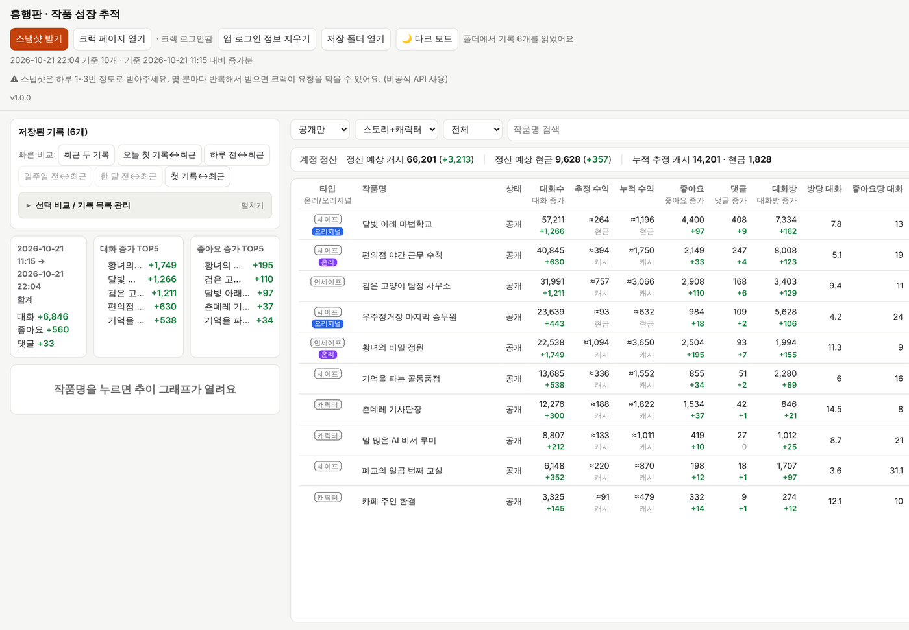
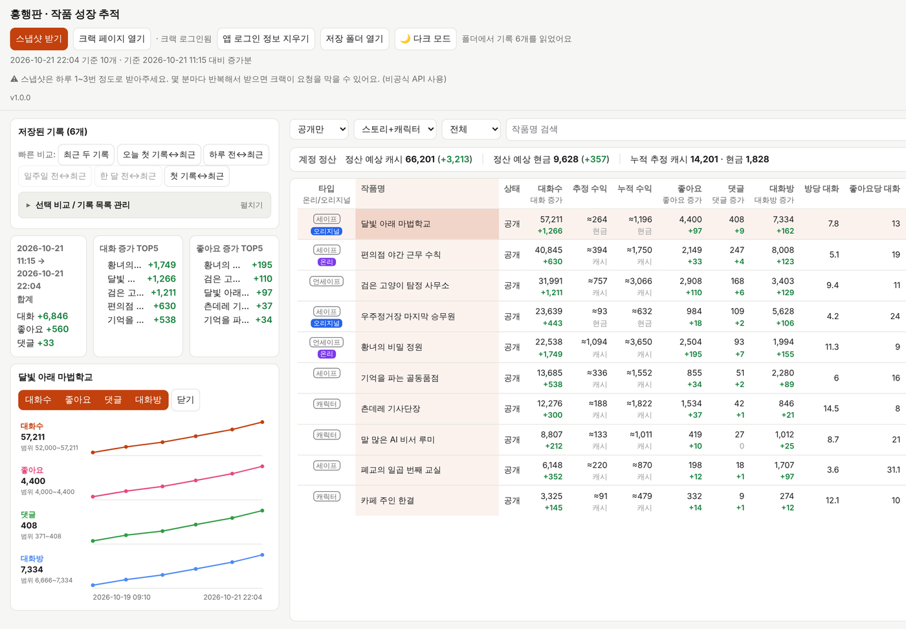
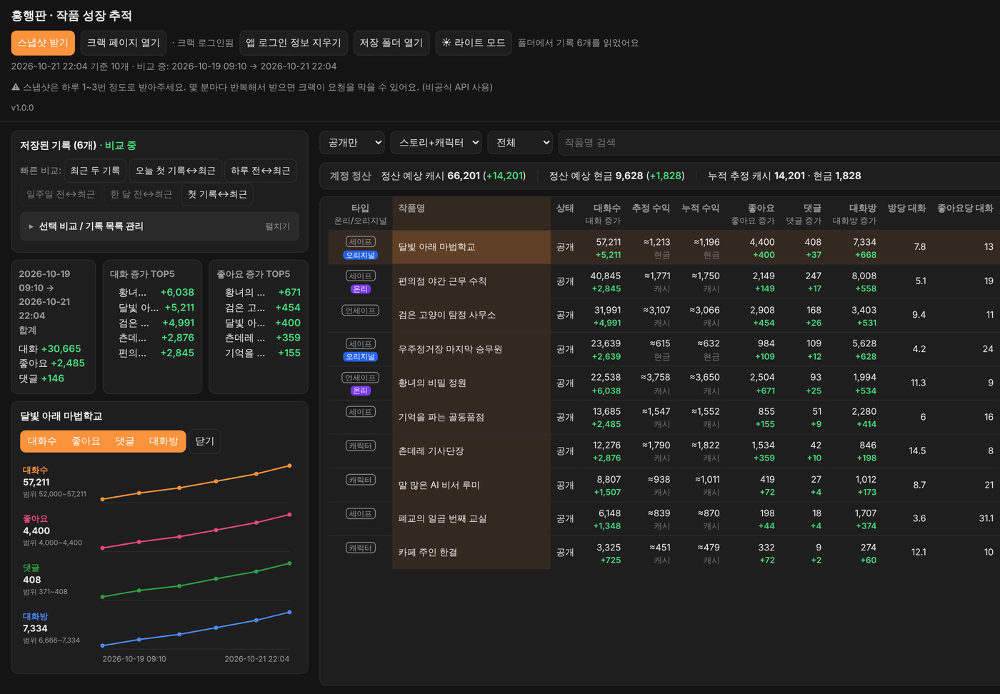

# 흥행판

크랙에 올린 **내 작품**의 대화수·좋아요·댓글·대화방 수를 스냅샷으로 모아서, 얼마나 늘었는지와 추이를 보는 Windows 앱이에요.

> 크랙(뤼튼)과 관계없는 개인 제작 도구예요. 크랙의 비공식 API를 쓰기 때문에, 크랙 쪽 사정이 바뀌면 갑자기 동작하지 않을 수 있어요.
>
> 넉넉한 취향이 클로드와 함께 만들었어요.



| 작품별 그래프 | 다크 모드 |
|---|---|
|  |  |

> 스크린샷의 작품과 숫자는 모두 가상의 데이터예요.

## 무엇을 볼 수 있나요
- 작품별 대화수·좋아요·댓글·대화방 수와 지난 기록 대비 증가량
- 방당 대화, 좋아요당 대화
- 원하는 두 기록을 골라 비교하기
- 세이프티·언세이프티·캐릭터 구분, 오리지널·온리 표시
- 계정 정산 예상액을 바탕으로 한 작품별 추정 수익과 누적 수익

## 받기
1. 오른쪽 **Releases**에서 `heunghaengpan-v1.0.0.exe`처럼 생긴 exe를 받아요.
2. 빈 폴더를 하나 만들어 그 안에 넣어 주세요 (예: 바탕화면의 `흥행판` 폴더). 실행하면 exe 옆에 `흥행판_스냅샷` 기록 폴더가 생겨요. **다운로드 폴더에서 바로 켜면 기록도 다운로드 폴더에 쌓이니**, 먼저 옮기고 켜 주세요.
3. Windows 10/11에서 동작해요. Windows 10에서 실행되지 않으면 Microsoft의 WebView2 런타임을 설치해 주세요.

### 실행할 때 경고가 뜨면
- 파란 창으로 **"Windows의 PC 보호"**가 뜨면 `추가 정보` → `실행`을 눌러요. 코드 서명을 하지 않은 개인 제작 앱이라 처음에는 이 경고가 떠요.
- 크롬이 다운로드를 막으면 다운로드 목록(`Ctrl+J`)에서 해당 파일의 `유지`를 눌러요.
- 백신이나 브라우저가 위험한 파일로 표시할 수도 있어요. 서명 없는 새 프로그램에서 생기는 오진인데, 그래도 찜찜하면 쓰지 않으셔도 돼요. 이 앱의 코드는 이 저장소에 전부 공개되어 있고, exe는 GitHub Actions가 이 코드로 직접 빌드한 거예요.

## 쓰는 법
1. **크랙 페이지 열기**를 누르면 앱 안에 크랙 페이지가 열려요. 거기서 평소처럼 로그인하고 창을 닫아요.
2. **스냅샷 받기**를 누르면 내 작품 통계를 받아 화면과 기록 폴더에 저장해요.
3. 다음에 다시 받으면 지난 기록과 비교해서 증가량이 보여요. 앱을 다시 켜면 기록은 자동으로 불러와요.

### 꼭 지켜 주세요
- **스냅샷은 하루 1~3번 정도만 받아 주세요.** 짧은 간격으로 계속 받으면 크랙이 요청을 막을 수 있어요. 크랙의 통계 숫자는 실시간이 아니라 약 1시간에 한 번씩 갱신돼서, 자주 받아도 숫자가 그대로인 경우가 많아요. 앱도 30분 안에 다시 받으려 하면 한 번 더 묻고, 막혔다고 판단되면 3시간 동안 쉬어요.
- **추정 수익은 대략적인 값이에요.** 계정 전체 정산 예상액을 작품별 대화 증가량 비율로 나눈 거라 실제 정산과 다를 수 있어요. 오리지널은 현금, 그 외는 캐시로 나눠 계산하고, 온리 가산 비율은 반영하지 않아요. 달이 바뀌는 구간은 일부가 빠질 수 있어 `누락 가능`으로 표시돼요.

## 로그인과 개인정보
- 로그인은 앱 안의 크랙 페이지에서 직접 해요. 앱은 비밀번호를 보거나 저장하지 않아요.
- 로그인 정보는 크랙 통계를 받는 데만 쓰고, 다른 곳으로 보내지 않아요.
- 받은 기록은 내 PC의 기록 폴더에만 저장돼요.
- 공용 PC에서 썼다면 **앱 로그인 정보 지우기**를 눌러 주세요. 앱 안 브라우저에 남은 크랙·구글 등의 로그인과 캐시가 지워져요. 기록은 그대로 남아요.

## 기록 폴더
- exe 옆의 `흥행판_스냅샷` 폴더에 스냅샷 한 번당 파일 하나씩 쌓여요.
- **exe를 다른 곳으로 옮길 때는 이 폴더도 같이 옮겨 주세요.** exe만 옮기면 새 자리에서 빈 기록으로 시작해요. (로그인은 PC에 따로 저장돼 있어서 그대로예요.)
- 화면에서 지운 기록은 바로 지우지 않고 `삭제됨` 폴더로 옮겨 둬요.
- `흥행판_수익장부.json`은 누적 수익을 계산하는 장부예요. 지우면 누적 수익이 처음부터 다시 쌓여요.
- exe 옆에 쓸 수 없는 위치면 `문서\흥행판_스냅샷`을 대신 써요.

## 새 버전으로 바꾸기
새 exe를 받아 원래 exe가 있던 폴더에 넣고 예전 exe는 지우면 돼요. 같은 폴더의 `흥행판_스냅샷`을 그대로 두면 기록도 이어져요.

## 개발자용
```
npm install
npm run build    # src-tauri/target/release/heunghaengpan.exe
```
Tauri 2로 만들었어요. 화면은 `viewer/흥행판_보기.html`, 앱 기능은 `src-tauri/src/bridge.js`와 `src-tauri/src/main.rs`에 있어요. `v`로 시작하는 태그를 붙이면 GitHub Actions가 exe를 빌드해 릴리스에 붙여요.

## 라이선스
MIT
